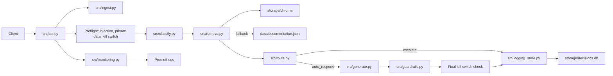

# Application Architecture

This is the complete reference for the support-ticket assistant: pipeline, modules, governance controls, monitoring, evaluation, configuration and limitations. [governance.md](governance.md) holds the detailed risk register and operating procedures; this document summarizes them in context.

## Overview

The service exposes `POST /process_ticket`. It validates and normalizes a ticket, screens it for private data and instruction-override attempts, classifies it, retrieves support documentation, decides whether to answer or escalate, drafts and checks a response when eligible, writes one audit record, and publishes Prometheus metrics. Anything uncertain escalates to a human; the system never returns a draft when a required step fails.



## Request Lifecycle

1. **Validate.** Pydantic requires `ticket_id` and `body`; `subject` defaults to empty because chat tickets often have none. Blank `ticket_id`/`body` and the literal Swagger placeholder `string` are rejected. Channel, tier, region and language fluency are restricted to known values, and unknown request or label fields are rejected (HTTP 422, not logged as decisions).
2. **Normalize.** `src/ingest.py` trims the subject and collapses whitespace in the body. The original ticket and labels stay in a `raw` field.
3. **Preflight (before any model call).** Recognized private data, instruction-override phrases and an active kill switch each escalate locally with no provider call.
4. **Classify.** `src/classify.py` (`PR-01-v1.2`) calls OpenRouter when a key is configured and the daily call budget allows, and validates intent, urgency, confidence and alternatives. Without a key it uses offline keyword rules (confidence 0.65, `offline_rules`), which are never eligible for an automatic reply. Provider failure or invalid output becomes zero confidence.
5. **Retrieve.** `src/retrieve.py` embeds intent, subject and body and asks Chroma for up to three passages with relevance scores and review-age metadata. The embedding store is cached and pre-loaded at API start-up (`warm_up_retriever`) so the first request is not slow. JSON-order fallback documents are unranked and force escalation.
6. **Route.** `src/route.py` escalates on: kill switch; confidence threshold outside 0.80-1.00; always-human intents (`security_incident`, `database_issue`, `compliance_request`, `feature_request`, `unclear_request`; the development data labels every ticket of the last three as must-escalate); explicit feature-request wording even if the classifier predicts a different intent; offline classification; `must_not_auto_respond` or `expected_route == "escalate"` labels supplied on the live API request; no documents; JSON-fallback documents; unknown or stale review age (`MAX_DOC_AGE_DAYS`); invalid or missing scores; best score below `MIN_RETRIEVAL_SCORE`; or confidence below the threshold. Evaluation labels remain withheld from the API.
7. **Draft and check.** For `auto_respond`, `src/generate.py` (`PR-03-v1.2`) is prompted to draft replies of at most 120 words and four steps from retrieved passages only. These are prompt constraints, not a separately enforced response-length validator. Provider failure returns no draft. `src/guardrails.py` then blocks private data, missing or unknown citations, unsupported commitments and prompt disclosure. The kill switch is checked again before returning.
8. **Persist and measure.** `src/logging_store.py` writes one privacy-minimized audit row. An unexpected exception writes a `pipeline_failure` row and escalates; if the audit write itself fails the API returns HTTP 503 and sends no answer. Prometheus receives ticket, latency, confidence and guardrail metrics.

Response keys: `ticket_id`, `intent`, `urgency`, `confidence`, `action`, `reason`, `response_text`, `sources_used` (de-duplicated document IDs) and `guardrails`. `response_text` is `null` when the action is `escalate`.

## File Guide

### Application source: `src/`

- `api.py`: FastAPI app, request schemas, pipeline orchestration, start-up warm-up, metrics server start, Uvicorn entry point.
- `ingest.py`: ticket normalization and the documentation chunking / Chroma index builder.
- `classify.py`: 22 intents, prompt loading, OpenRouter call, output validation, offline fallback, daily call reservation.
- `retrieve.py`: cached Chroma similarity search, `warm_up_retriever()`, JSON fallback.
- `route.py`: all escalation rules listed above.
- `generate.py`: response prompt, source context, OpenRouter call.
- `guardrails.py`: inbound injection/private-data detection; outbound private-data, citation, commitment and prompt-disclosure checks.
- `logging_store.py`: migration-safe `decisions` table, `llm_usage` table, decision insertion, atomic daily budget. Database path comes from `DATABASE_URL`.
- `monitoring.py`: Prometheus metrics and metrics-server start-up.

### Prompts: `prompts/`

`classify_v1.txt` (`PR-01-v1.2`) and `respond_v1.txt` (`PR-03-v1.2`) contain the classifier and response prompts; see `prompts/README.md`. Retrieval is tracked as `PR-02-v1.0` in `src/retrieve.py` and has no separate prompt text file. Prompt/version identifiers are recorded in decision logs when the corresponding stage runs.

### Evaluation: `evaluation/`

- `harness.py`: runs a labelled ticket file through the real pipeline and writes a JSON report.
- `metrics.py`: percentile and latency summary, Wilson interval, per-class classification summary with confusion matrix, calibration table, cross-group variation.
- `review.py`: human-review export and scoring.
- `results/`: generated reports, per-run decision databases (`*.decisions.db`, ignored by Git) and `run_log.jsonl`.

### Data and generated state

- `data/development_tickets.json` (500), `validation_tickets.json` (80), `ground_truth_responses.json` (200, development IDs), `documentation.json` (29 records).
- `storage/chroma/` vector index and `storage/decisions.db` audit log are generated.

### Root files

`data-chunking.py`, `init_db.py` and `monitoring.py` are thin wrappers; `prometheus.yml` scrapes `localhost:8001`; `requirements.txt` pins dependencies; `.env.example` lists safe defaults; `.github/workflows/ci.yml` runs the offline test suite; `test-APIKey.py` is a manual provider check (not in CI). `FDE_Capstone_Report_Draft.md` is the submission report draft and contains author-completion placeholders.

### Tests: `tests/`

- `test_api.py`: pipeline, validation, response shape.
- `test_governance.py`: decision logging, guardrails, kill switch, injection and private-data screening, fairness segments.
- `test_evaluation.py`: metric helpers, label withholding, blank subjects, simulated outage, review round trip.
- `test_project_setup.py`: dataset schemas, normalization, SQLite, harness, prompt fallback.

## Governance

Requirement IDs recorded on decisions: `GOV-LOG-01` (one record per processed ticket), `GOV-ROUTE-01` (fail closed), `GOV-PRIV-01` (private-data screening), `GOV-KILL-01` (kill switch).

### Risk register

Scores are likelihood x impact on a 1-3 scale; any impact-3 risk needs a control before automatic replies are enabled. Owner for all: Nabieesan, project owner/operator.

| ID | Risk | Score | Main control |
|---|---|---:|---|
| R-01 | Confidently wrong answer sent | 6 | Confidence floor 0.80-1.00, citation validation, retrieval score floor, kill switch |
| R-02 | Private data reaches provider or reply | 6 | Local pre-provider screen and outbound scan; match blocks the reply |
| R-03 | Prompt injection or prompt disclosure | 6 | Phrase detection before model calls, untrusted-data prompts, output disclosure check |
| R-04 | Worse answers for some customer groups | 4 | Segment reporting and best-versus-worst gap check |
| R-05 | Stale documentation | 4 | Review-age metadata; unknown or old sources escalate |
| R-06 | Provider outage or invalid output | 4 | Timeouts, daily budget, zero-confidence escalation |
| R-07 | Latency under load | 4 | Timeouts and p95 measurement; no load test yet |
| R-08 | Unexpected provider cost | 4 | Atomic daily call cap and output token caps |

### Decision logging

Every valid request yields one `pipeline_complete` or `pipeline_failure` row with: decision ID, timestamp, ticket ID, stage, privacy-minimized `input_summary` (counts and metadata, no raw text), `model_name`, `prediction_json`, `alternatives_json`, `sources_used` with scores, `threshold`, `action_taken`, `reason`, `guardrails`/`guardrail_results`, `stage_results`, `prompt_version` and `requirement_ids`. Prompts and source excerpts are deliberately not stored. Coverage check:

```sql
SELECT stage, COUNT(*) AS decisions, COUNT(DISTINCT ticket_id) AS tickets FROM decisions GROUP BY stage;
```

### Runtime guardrails

| Guardrail | Behaviour |
|---|---|
| Private data | Pattern scan for secrets, emails, phone numbers, `CUST-` IDs, card-like numbers; inbound match escalates locally, outbound match blocks the draft |
| Grounding | At least one `[Doc ID: ...]` citation, each matching a retrieved document |
| Instruction integrity | Override phrases escalate before model calls; disclosure in output is blocked |
| Tone and scope | Unsupported refund or fix-date commitments are blocked |
| Feature-request safety | Clear feature-request wording is detected independently of the predicted intent; matching tickets escalate to human review |
| Confidence floor | Threshold must be 0.80-1.00; offline or failed classification never auto-replies |
| Evidence freshness and ranking | Fallback, unscored, stale or low-scoring evidence escalates |

These are pattern checks, not comprehensive data-loss prevention or proof that each sentence is entailed by its source.

### Kill switch and incident response

Create `storage/AUTO_RESPONSE_DISABLED` to stop all automatic replies; new requests escalate with no provider call and a draft completed in flight is suppressed at the final check. Remove the file only after review. Incident steps: detect (acknowledge within 15 minutes), contain (kill switch within 5 minutes), assess (scope within 30 minutes), notify (internal notice within 1 hour), remediate with a regression test, review within 2 working days. These are internal targets, not legal deadlines.

### Declaration

The system must never send a draft when processing, classification, retrieval, generation or a required guardrail fails. It would not be deployed without independent testing of DLP and grounding limits, load and fairness review on representative data, a secured and retention-limited audit database, a named incident contact, and a demonstrated kill switch.

## Evaluation

### Running

```bash
python -m evaluation.harness data/validation_tickets.json evaluation/results/validation_run01.json --gate
python -m evaluation.harness data/development_tickets.json evaluation/results/development.json --ground-truth data/ground_truth_responses.json
```

Options: `--ground-truth`, `--human-review <summary.json>`, `--simulate-provider-outage`, `--gate`, `--no-warm-up`, `--run-log <path>`. The input path is not hardcoded, so a hidden set can be passed at assessment time. Use a new output path for each run: the matching `<output>.decisions.db` is deleted and rebuilt when that path is evaluated again. Provider-backed evaluation requires `OPENROUTER_API_KEY` and makes model calls that may incur cost. `--gate` exits with code 1 when a measured target fails or the run is invalid; inspect both `gate.passed` and `validity.valid_for_gate`. An outage simulation tests failure handling but is not a valid performance-gate run.

### How it works

- Each ticket goes through `api.process_ticket_endpoint` with labels withheld, so routing, guardrails, kill switch and audit logging match production. Earlier versions leaked ground-truth labels into routing and inflated route and protected-ticket results.
- A per-run decision database (`<output>.decisions.db`) is reconciled against tickets processed (missing, duplicated and unexpected rows are reported).
- Decision records include classification, retrieval and generation timings when those stages complete. The report summarizes them under `service.stage_latency_seconds`; these stage distributions do not include network time between an API client and the service, and their percentiles must not be added together.
- Runs using offline classification, a simulated outage or an active kill switch are marked `valid_for_gate: false`. A real gate run needs `OPENROUTER_API_KEY`.
- Every run is appended to `evaluation/results/run_log.jsonl`, keyed by input hash, for comparison with earlier runs.
- `--gate` exits with code 1 if a measured target fails or the run is invalid.

### Latest Validation Snapshot

The saved provider-backed report `evaluation/results/validation_postfix.json` was generated on 17 November 2026 using `meta-llama/llama-3.1-8b-instruct`, prompt versions `PR-01-v1.2`, `PR-02-v1.0`, and `PR-03-v1.2`, and 80 validation tickets. The manifest records commit `06afa65` with uncommitted system changes, so this is a snapshot rather than a clean, reproducible release result. It is valid for gate evaluation, but the overall gate failed.

Weighted intent precision was 97.1% against a target of at least 85%; intent accuracy was 96.25%, urgency accuracy 42.5%, route accuracy 67.5%, and answerability accuracy 66.25%. The system returned automatic responses for 56 tickets and escalated 24 (30%). Dataset labels expect 32 escalations (40%), so the escalation ceiling and labelled route distribution conflict and should be reconciled with the assessment rubric rather than addressed by overriding safety labels. Protected-ticket responses were 0/14 in this run; this is a finite test of the feature-request safeguard, not proof all protected cases are safe.

End-to-end p95 latency was 16.50 seconds against a target under 3 seconds. Mean stage durations were 5.49 seconds for classification, 0.056 seconds for retrieval, and 4.50 seconds for generation; provider calls dominate this measured run. The maximum group quality gap was 14.2 points against a target under 5, but group comparisons are unreliable because the smallest group had seven tickets. Calibration gap was 10.5 points against a five-point tolerance. Decision logging reconciled 80/80 records, and the pattern-based private-data scan found 0 matches in 56 returned responses. No provider outage was exercised. Hallucination rate, semantic citation accuracy, and satisfaction were not scored because no human review was supplied; repeat contacts are not measurable offline.

These metrics are proxies or small-sample estimates, not evidence of production performance. The validation set has been reused during development, and the evaluated tree was dirty. Do not present this as an independent final holdout result.

### Report contents

Manifest and validity; gate result; a results table (baseline, target, achieved, status, confidence in the figure, notes) for first contact resolution, mean time to first reply, satisfaction proxy, escalation rate, repeat contacts, weighted classification precision, hallucination rate, citation accuracy, p95 latency, availability, private data in outbound text, quality across customer groups, decision logging, confidence calibration and protected-ticket auto-responses; a caution statement; accuracy metrics (intent, urgency, route, answerability); retrieval Hit@3 and Recall@3; citation precision and recall; per-class precision with confusion matrix; calibration bands; latency summaries; retrieval score summary; escalation reasons; and slices by tier, region, language fluency and ticket length.

Statuses are `pass`, `fail`, `not_measured`, `needs_human_review` and `not_measurable`.

### Fairness segments

For each segment the report gives ticket count, resolution rate, quality score and variation from the best segment. Resolution rate is the share of expected-auto-respond tickets that were auto-answered with all expected citations and no guardrail violation. Quality score averages six checks: intent, urgency, route, answerability, governance safety and citation coverage. Groups under 20 tickets are flagged low-confidence. This is a proxy, not a validated customer outcome; the ground-truth `history` field is a human baseline, not a model target.

### Human review

Hallucination rate, citation accuracy and satisfaction need human judgement:

```bash
python -m evaluation.review export evaluation/results/validation_run01.json evaluation/results/review_run01   # default 50 responses, seeded
# assessor A fills the a_* columns, assessor B the b_* columns, independently
python -m evaluation.review score evaluation/results/review_run01
```

Scoring uses responses completed by both assessors: hallucination if either flags an unsupported claim, citation accurate only if both judge it supported, satisfaction as the mean 1-5 score, plus percentage agreement and Cohen's kappa. Fewer than 50 responses is reported as an insufficient sample. The current harness can accept the summary through `--human-review`, but it reruns model inference and does not bind review rows to those newly generated responses. Use a distinct output path; the combined report may describe a different generation run and incur additional provider costs. Preserve the original inference report and treat the human metrics as not matched to it unless run-to-row linkage is added.

Repeat contacts cannot be measured offline because the datasets do not link tickets from the same customer.

## Monitoring

`python -m src.api` serves the API on port 8000 and metrics at `http://localhost:8001/metrics` (`API_PORT`, `METRICS_PORT` override). Do not run `monitoring.py` on the same port at the same time. Run Prometheus with `prometheus --config.file=prometheus.yml`; if the hostname breaks URL parsing add `--web.listen-address=127.0.0.1:9090 --web.external-url=http://localhost:9090/`.

## Environment and Run Commands

```bash
python3.11 -m venv .venv
source .venv/bin/activate
python -m pip install -r requirements.txt
cp .env.example .env
python init_db.py
python data-chunking.py
python -m src.api
python -m pytest tests/ -v
```

Settings: `OPENROUTER_API_KEY` (empty selects offline mode), `MODEL_NAME`, `EMBEDDING_MODEL`, `CHROMA_PATH`, `DATABASE_URL`, `CONFIDENCE_THRESHOLD` (0.80-1.00), `MIN_RETRIEVAL_SCORE` (0.30), `MAX_DOC_AGE_DAYS` (180), `MAX_LLM_CALLS_PER_DAY` (100), `AUTO_RESPONSE_KILL_SWITCH_FILE`, `API_HOST`, `API_PORT`, `METRICS_PORT`. If a key is configured, ticket text that passes the local screen is sent to the provider, and evaluation runs make real model calls.

## Current Limitations

- Prototype: no operational actions, caller authentication, distributed rate limiting, load-tested SLO, or audit-log retention.
- Dataset `history` fields are not used by the live pipeline.
- Guardrails are pattern and citation-ID based; they cannot detect arbitrary names or prove semantic support.
- An in-flight provider call can take up to its timeout after the kill switch is activated.
- The 0.30 retrieval floor and duplicated top-3 chunks may need calibration against real runs; the report's retrieval scores and escalation reasons help with this.
- Evaluation requires labels, so unlabeled production input is not a valid evaluation dataset. A provider-backed snapshot exists at `evaluation/results/validation_postfix.json`, but it is from a reused validation set and a dirty source tree, and fails latency, group-quality, and calibration gates.
- `.env.example` contains placeholders, not usable credentials.
